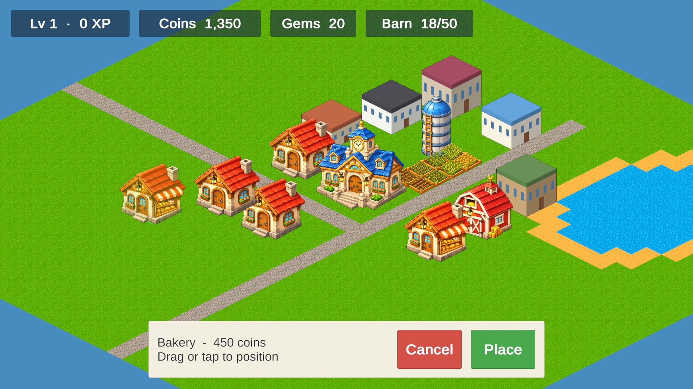

# TownBuilder (working title)

An original 2D isometric farming and town-building game for Android, built AI-first with Unity 6.

> Genre inspiration: town-building and farming simulators. All art, UI, names and mechanics in this project must be original.

## Status: v0.1 playable prototype complete (Milestone 2: farming, barn, bakery, orders and levels) · Milestone 3 steps 1–2 (construction, sound) · v0.5.0

| Feature | State |
|---|---|
| Boot → Main menu (Continue / New Game / Settings) → Town | ✅ |
| 36×36 isometric map (grass, sand, lake, roads) authored in tilemaps | ✅ |
| Camera: drag with inertia, pinch and mouse-wheel zoom, map bounds | ✅ (verify on device) |
| Build shop, placement preview, validation, move, remove | ✅ |
| Coins / gems / level HUD | ✅ |
| Offline JSON save: atomic writes, backup recovery, schema migration, autosave | ✅ |
| AdMob test ads: rewarded "+100 coins", interstitial on Menu, GDPR consent ([Ads.md](Documentation/Ads.md)) | ✅ (test ids) |
| Farming: fields, Wheat/Corn growth timers, harvest, barn capacity, "Finish now" ad | ✅ |
| Barn screen: sell crops for coins, paid barn expansion | ✅ |
| Bakery: Bread / Corn Bread recipes, production queue, tap to collect, "Finish now" ad | ✅ |
| Orders and levels: order board, level curve, level-up rewards and unlocks | ✅ |
| Construction timers with ad / gem speed-up | ✅ |
| Sound effects and music (original placeholders, [Audio.md](Documentation/Audio.md)) | ✅ |
| Visual feedback: selection outline, building pops, floating "+2 Wheat" rewards, top-bar pops | ✅ |
| Sharp TextMeshPro UI text (Liberation Sans, OFL) | ✅ |
| Feed Mill + Soybean: Chicken Feed and Cow Feed (Milestone 4 step 1) | ✅ (placeholder art) |
| Animal buildings: Chicken Coop (eggs), Dairy Shed (milk) (Milestone 4 step 2) | ✅ (placeholder art) |
| Sugarcane + Sugar Mill (Milestone 4 step 3) | ✅ (placeholder art) |
| Sweets and dairy: Cookies, Cake, Creamery (Butter, Cheese) (Milestone 4 step 4) | ✅ (placeholder art) |
| Automated tests: 93 EditMode + 35 PlayMode | ✅ |
| First AI art set (buildings, field, crops, items, ground) + `AiArtImporter` tool | ✅ |
| Android build | ⏳ install the Android Build Support module first |



## Requirements

* **Unity 6000.6.8f1** (Unity Hub). Add the modules **Android Build Support**, **Android SDK & NDK Tools** and **OpenJDK**.
* Git.

## Getting started

1. Unity Hub → **Add project from disk** → select this folder.
2. Open `Assets/_Game/Scenes/Boot.unity` and press **Play**. MainMenu and Town also run when opened directly.
3. Controls in the Editor: left-drag to pan, mouse wheel to zoom, click to select. On a device: drag, pinch, tap.

### Useful menus

| Menu | What it does |
|---|---|
| TownBuilder → Setup → Run Full Setup | Recreates missing folders, settings, placeholder art, content assets, prefab and scenes (keeps existing files) |
| TownBuilder → Setup → Rebuild Scenes | Regenerates the three scenes (overwrites manual scene edits) |
| TownBuilder → Setup → Reimport Art | Force-reimports everything under `Art/` |
| TownBuilder → Saves → Open Save Folder / Delete Local Save | Inspect or reset the Editor save |
| TownBuilder → Debug → Capture Town Preview | Renders `Temp/TownPreview.png` to check art alignment and sorting |
| Window → General → Test Runner | Run EditMode and PlayMode tests |

### Command line (CI or agents)

```bash
UNITY="/c/Program Files/Unity/Hub/Editor/6000.6.8f1/Editor/Unity.exe"
"$UNITY" -batchmode -quit -projectPath . -executeMethod TownBuilder.EditorTools.ProjectSetup.RunFromCommandLine -logFile Logs/setup.log
"$UNITY" -batchmode -projectPath . -runTests -testPlatform EditMode -testResults Logs/TestResults-EditMode.xml -logFile Logs/tests.log
"$UNITY" -batchmode -projectPath . -runTests -testPlatform PlayMode -testResults Logs/TestResults-PlayMode.xml -logFile Logs/tests-play.log
```

Don't pass `-nographics` to the setup or preview commands. Textures imported without a GPU come out blank.
Close the Editor before running batch commands on this project.

### Android build (after installing the module)

1. File → Build Profiles → Android → **Switch Platform**.
2. Player settings are already set: `com.pandian47.townbuilder` (permanent Play Store id), IL2CPP, ARM64, min API 26, Vulkan + GLES3, Landscape Left.
3. Connect a phone with USB debugging enabled → **Build And Run** (APK for testing; enable *Build App Bundle* for Google Play).
4. Work through the device checklist in `Documentation/DevelopmentRoadmap.md` (Milestone 1 acceptance).

## Project layout

```
Assets/_Game/
  Art/            sprites (file names keep the PH_ prefix) and tile assets
  Data/           BuildingDefinition assets (static content)
  Editor/         ProjectSetup, SceneBuilder, PlaceholderArtGenerator, PreviewCapture
  Prefabs/        BuildingView prefab
  Scenes/         Boot, MainMenu, Town
  ScriptableObjects/GameContent.asset   content catalogue and new-game values
  Scripts/
    Domain/       pure C# rules (no UnityEngine): grid, town, wallet, saves
    Core/ Input/ Camera/ Grid/ Building/ SaveSystem/ UI/ World/   Unity layer
    Farming/ Factory/ Inventory/ Economy/ Progression/ Orders/ Transport/   (next milestones)
  Settings/       URP 2D renderer, pipeline asset, input actions
  Tests/          EditMode + PlayMode
Documentation/    Architecture, GameDesign, ArtStyleGuide, AssetImportGuide, GameEconomy, DevelopmentRoadmap
CLAUDE.md         rules for AI coding agents working in this repo
```

Start with [Documentation/Architecture.md](Documentation/Architecture.md).
